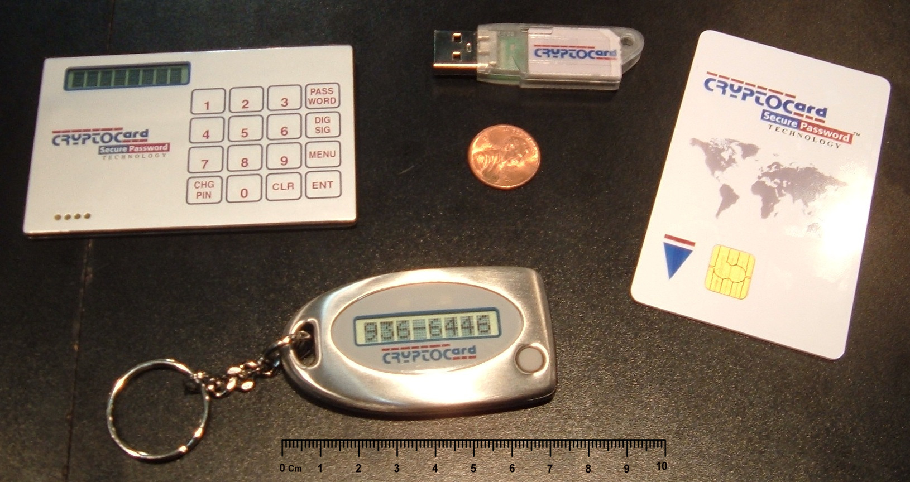

Most people searching for a digital signature certificate price in Nepal want one number. The honest answer is a set of numbers, and they come from two web pages that carry no date.

We read everything we could find that publishes a price, checked each figure against the law, and wrote down what we could not confirm. Prices were checked on 20 October 2026. Where a page says nothing, we say "not published" rather than guess.

If you are still deciding whether you need a certificate at all, start with [what a digital signature is worth in Nepal](/blog/what-is-a-digital-signature-nepal). If you already know, this is the page about money. For the application steps, see [how to get a digital signature certificate in Nepal](/blog/how-to-get-digital-signature-certificate-nepal).

## How many licensed certifying authorities are there?

The question comes first because a price comparison needs more than one seller.

Under the Electronic Transactions Act, 2063, [section 30](https://radiantca.com.np/assets/nav_file/Electronic%20Transaction%20Act%202063.pdf) lets only a licensed or recognised certifying authority issue a digital signature certificate. Section 15 forbids anyone to perform a certifying authority's functions without a licence. Section 23 adds a second route: the Controller may, with the Government's prior approval and by notice in the Nepal Gazette, recognise a foreign authority, which may then issue certificates under the Act throughout Nepal.

Two things changed how we have to answer.

**The Controller's office has moved.** The old Office of the Controller of Certification used the address occ.gov.np. That address now redirects to the website of the [National Cyber Security Center](https://ncsc.gov.np/). The Center's front page carries a notice titled, in Nepali, "Notice regarding the merger of the Office of the Controller of Certification into this Center", dated 22 Bhadau 2083. The notice itself is a separate attachment that we could not read, so we only know what its title says. The same site has a menu entry for regulating certifying authorities and granting licences, plus the root CA, its CPS and the PKI guidelines.

**The list we can see has one name on it.** The Center's page of [CA certificates](https://ncsc.gov.np/pages/1084212723/) is the list of certificates the national root has signed. On 20 October 2026 it shows:

| Certificate | Valid from | Valid to | Status |
|---|---|---|---|
| Radiant InfoTech Nepal CA 2025 | 25 Nov 2025 | 25 Nov 2030 | Existing |
| Radiant InfoTech Nepal CA 2020 | 6 Mar 2020 | 6 Mar 2027 | Existing |
| Radiant InfoTech Nepal CA 2015 | 1 Dec 2015 | 1 Dec 2020 | Expired |
| Radiant InfoTech Nepal Sub CA 2015 | 1 Dec 2015 | 1 Dec 2020 | Expired |

Every entry belongs to Radiant InfoTech Nepal. That does not prove no other authority holds a licence, because a licence and a root-signed CA certificate are different records. It does mean we found no second authority anywhere. We also found no page that lists licences, in English or Nepali.

> [!NOTE]
> "Every licensed certifying authority compared" turns out to be a comparison of one authority's two published price lists. If a second licensed authority exists and publishes prices, we have not found it.

## Who sells the certificate

There are two websites, and they describe one arrangement.

[Radiant CA](https://radiantca.com.np/brief-description/about-us) calls itself "a licensed certifying authority". Its About page lists Radiant InfoTech Nepal Pvt. Ltd. as the issuing CA and says the company has a PKI setup with its primary site in Kathmandu and a disaster recovery site at Butwal. The same page lists Nepal Certifying Company (NCC) as the management partner.

[NCC's own site](https://cert.com.np/) describes NCC as "the Management Partner / Registration Authority of Radiant CA". It says NCC was established in 2013, and its pages show an office in Naxal, Kathmandu. A registration authority is the part that takes your application and checks your documents. The certifying authority is the part that signs your certificate. [What a certificate authority is](/blog/what-is-a-certificate-authority) explains the split.

In practice you apply and pay at an NCC or Radiant registration office, and the certificate chains up through Radiant's CA to the national root.

## The price tables

Both lists are in Nepali rupees. Both exclude government taxes and charges. They differ on tokens.

- **Radiant's list** says "the prices mentioned above are inclusive of token price".
- **NCC's list** says "the prices are exclusive of token price", and "the price of available token is Rs. 1200 and it differs with different types of tokens".

So, to compare, add Rs 1,200 to each NCC figure. We have done that in the last column. It is our arithmetic, not a price either page prints, and the token price you actually pay depends on the token.

### Signing certificates only

"Signature" here means the certificate you sign with. Each price is for one certificate.

| Class and type | Validity | [Radiant list](https://radiantca.com.np/brief-description/certificates-price) (token included) | [NCC list](https://cert.com.np/certificates-price-list) (token excluded) | NCC plus Rs 1,200 token |
|---|---|---|---|---|
| Class 1 individual | 1 year | Rs 2,400 | Rs 1,200 | Rs 2,400 |
| Class 1 individual | 2 years | Rs 3,000 | Rs 1,800 | Rs 3,000 |
| Class 2 individual | 1 year | Rs 3,000 | Rs 1,800 | Rs 3,000 |
| Class 2 individual | 2 years | Rs 3,700 | Rs 2,500 | Rs 3,700 |
| Class 2 enterprise | 1 year | Rs 3,000 | Rs 1,800 | Rs 3,000 |
| Class 2 enterprise | 2 years | Rs 3,700 | "N/A at the moment" | not sold |
| Class 3 individual | 1 year | Rs 4,900 | Rs 3,700 | Rs 4,900 |
| Class 3 individual | 2 years | Rs 6,200 | "N/A at the moment" | not sold |
| Class 3 enterprise | 1 year | Rs 5,100 | Rs 3,900 (see below) | Rs 5,100 |
| Class 3 enterprise | 2 years | Rs 7,000 | "N/A at the moment" | not sold |
| Class 3 server and device | 1 year | Rs 5,100 | Rs 3,900 | Rs 5,100 |
| Class 3 server and device | 2 years | Rs 7,000 | Rs 5,800 | Rs 7,000 |

Every figure that both lists print agrees once the token is added. That is a good sign that the two lists describe one price book. The disagreement is only about what is still on sale: NCC marks three of the two year plans as "N/A at the moment", while Radiant still lists them.

For Class 3 enterprise, NCC's page does not print a plain signature price in the table. It gives worked invoices instead. Two of them, labelled "EBPS (Municipality)" and "Ncell Vendor", show a hard token certificate at Rs 3,900 for one year. We took Rs 3,900 from those.

### Signing plus encryption

Both lists have a second column for "both DSC and encryption", for people who also want to receive encrypted email or files. It is a different price from the signature-only column.

| Class and type | 1 year | 2 years | Listed by |
|---|---|---|---|
| Class 1 individual | Rs 3,750 | Rs 5,150 | Radiant only. NCC shows N/A |
| Class 2 individual | Rs 3,750 | Rs 5,150 | Both |
| Class 2 enterprise | Rs 3,750 | Rs 5,150 | Radiant. NCC shows 1 year only |
| Class 3 individual | Rs 7,550 | Rs 10,150 | Radiant. NCC shows 1 year only |
| Class 3 enterprise | Rs 7,950 | Rs 11,750 | Radiant. NCC shows 1 year only |
| Class 3 server and device | Rs 7,950 | Rs 11,750 | Both |

One oddity we cannot explain. Where both lists print a figure in this column, it is identical, even though one list says tokens are inside the price and the other says they are outside. We do not know whether the token is inside these particular figures. Ask before you buy the bundle.

### Other rows on Radiant's list

Radiant's list has two Class 3 enterprise rows marked "(GIOMS)". A soft token version is Rs 1,800 for one year and Rs 3,600 for two. A crypto token version is Rs 3,000 for one year and Rs 4,000 for two. The page does not say what GIOMS stands for or who may buy these rows, so we have not tried to interpret them. If you think they apply to you, ask the registration office.

## What the classes mean

The price rises with the class, so it helps to know what you are paying for. Radiant's [class of certificates](https://radiantca.com.np/brief-description/class-of-certificates) page puts it this way.

- **Class 1** is for business personnel and private individuals. It confirms that the details in the application do not conflict with a well recognised consumer database. The page says it gives a basic level of assurance where the risk of compromise is not considered major.
- **Class 2** is also for business personnel and individuals, with the same database check. It is meant where risk is moderate, which includes transactions of substantial monetary value or a risk of fraud.
- **Class 3** is for individuals and organisations. The page calls it a high assurance certificate "primarily intended for e-commerce applications" and says that individuals receive it "only on their personal (physical) appearance before the Certifying Authorities".

The practical consequence is in the second sentence of the Class 3 entry. If the certificate you need is Class 3, plan a visit. A bank or a tender portal that asks for "a digital signature" may mean a particular class, so ask which one before buying.

## What is added on top

### Tax

Both lists exclude taxes. NCC's page does not leave the arithmetic to you. It prints three invoices for Class 3 enterprise buyers, labelled as below, and adds 13 percent VAT to each:

| Item | EBPS (Municipality) | Ncell Vendor | ECHS (Indian Embassy) |
|---|---|---|---|
| Certificate, 1 year, hard token | Rs 3,900 | Rs 3,900 | Rs 7,950 (signature with encryption) |
| Crypto token | Rs 1,200 | Rs 1,200 | Rs 1,200 |
| Total | Rs 5,100 | Rs 5,100 | Rs 9,150 |
| VAT at 13 percent | Rs 663 | Rs 663 | Rs 1,189.50 |
| Grand total | Rs 5,763 | Rs 5,763 | Rs 10,339.50 |

Using the same method, a Class 2 individual certificate for one year costs Rs 3,000 with the token and Rs 3,390 with VAT. That figure is ours. NCC prints invoices only for the three buyers above, so we do not know whether every buyer is charged VAT in the same way. Business buyers who claim VAT back should still ask for a VAT invoice.

### The printed certificate

Both lists end with the same line: the hard copy certificate costs Rs 100 "as per Electronic Transaction rules 2064". The Rules agree. [Rule 32(2)](https://radiantca.com.np/assets/nav_file/Electronic%20Transaction%20Rules%202064.pdf) says a certificate is issued after the applicant has had the chance to check the details in it, "upon receiving One Hundred Rupees as fees for the certificate". It is a small number, and it is the only certificate fee the Rules themselves set.

### The token

The token is the largest add-on, at Rs 1,200 on NCC's list, and it is the part of the price that varies. Its job is to keep your private key inside a device that will not let the key out. [USB tokens](/glossary/usb-token) are strong for that reason and awkward for the opposite reason: you need the device, a computer and often a driver. NCC's support pages list an installation guide for one named token model, dated 2 February 2026, so tokens are still in current use.

## What the price lists do not say

A price per certificate is only part of a cost. Neither list publishes any of the following, and we found it nowhere else:

- **Renewal.** Whether renewing is a new full application at the full price, or cheaper.
- **Replacement.** What a lost token costs, or a replacement after revocation.
- **Revocation.** Whether it is free. Radiant's site offers a revocation form, but no page we read states a fee for revocation.
- **Mobile keys.** Neither list has a row for a certificate whose key lives in a phone.
- **Date.** Neither page says when it was last updated. NCC's footer reads 2020, and its site was clearly edited more recently, since its software page shows an item dated 19 December 2025.

That last point matters most. You should treat any figure on this page, including ours, as a number to confirm before you pay, not a quote.

## How this compares with 2015

Digital signatures were launched for the public in December 2015. The Himalayan Times [reported at the time](https://thehimalayantimes.com/ampArticle/136646) that Radiant InfoTech Nepal, "in coordination with" NCC, had opened registration, that the signature came on a password protected USB token, and that "users will have to pay Rs 2,500 to obtain the digital signature in a token". The article does not say which class that was. Today's Class 1 individual with a token, at Rs 2,400 for a year, is close to it. Class 2 and Class 3 cost more.

The same report said the signatures could only be used at consumer level at that point. Government offices were still preparing the infrastructure to accept them.

## Why there are so few sellers

A certifying authority has real obligations, and the Rules set them out. It helps explain why a market of two websites is small.

Under [rule 12](https://radiantca.com.np/assets/nav_file/Electronic%20Transaction%20Rules%202064.pdf) of the Electronic Transaction Rules, 2064, an applicant for a licence files with a fee of Rs 500 and needs paid-up capital of at least Rs 10 million, or assets equivalent to it. The licence application also needs a bank guarantee of Rs 2.5 million. Rule 14 sets the licence fee at Rs 25,000, and rule 15 makes the licence last two fiscal years. Rule 16 sets renewal at Rs 20,000, with the guarantee, applied for 30 days before expiry.

Those are the stated entry costs. The ongoing duties are in section 27 of the Act, which lets the Controller audit a certifying authority's performance. The Rules provide for annual performance audits and, if a certifying authority stops business, for keeping its certificate records for up to seven years. A company that wants to compete on price has to meet all of that first.

## The law on how fast they must answer

One protection does not depend on any price list. Section 31 of the Act says that after you apply, the certifying authority must decide whether to issue within one month. If it decides to issue, it must do so within seven days. If it rejects you, it must tell you the reasons within seven days.

So the fee buys a decision on a clock. If your application sits for weeks with no answer, you are not being asked to wait politely. The law has a deadline, and you can quote it.

## How to compare prices honestly

When a price reaches you by phone or message, five questions put it on the same footing as the lists above.

1. **Which class is it?** Class 1, 2 and 3 are priced very differently, and Class 3 needs a visit.
2. **How many years?** A two year certificate is cheaper per year than a one year one.
3. **Is the token in the price?** Ask for the token cost in a separate line.
4. **Is VAT in the price?** The published lists say no.
5. **What happens at renewal and on loss?** These costs are unpublished.

Then check the issuer. A seller who cannot name the licensed certifying authority behind the certificate is selling something the Act does not recognise. See [how to check a signed PDF](/blog/how-to-check-a-signed-pdf) to confirm after you sign that the certificate chain ends at a root your reader trusts.

## Where ePahichan fits

ePahichan is not a certifying authority and is not in the tables above. It is an app and a signing API. Its pages say the certificate in the app is issued by Nepal Certifying Company, and that the fee is shown in the app before you pay, through Fonepay or a bank or wallet app. We do not publish an ePahichan price here, because the price you pay is the one the app shows at the time.

What the ePahichan app changes is where the key lives. Your signing key is made on your phone and kept in its secure hardware, so there is no token to buy. If you are comparing a token certificate with a phone certificate, remember that the Rs 1,200 token line in the tables above has no equivalent on a phone.

## What we could not verify

- A list of licences. We found none published, in English or Nepali. The National Cyber Security Center notice about the Controller's office is an attachment we could not open.
- Whether any foreign certifying authority has been recognised under section 23.
- The date of either price list, and whether either is the current price book.
- What GIOMS means on Radiant's list.
- Renewal, replacement and revocation fees.
- Whether the token is inside the "both DSC and encryption" column on NCC's list.

We would rather correct this page than leave a stale number on it, so treat the date at the top as the date of the check, not a promise that prices have held.
