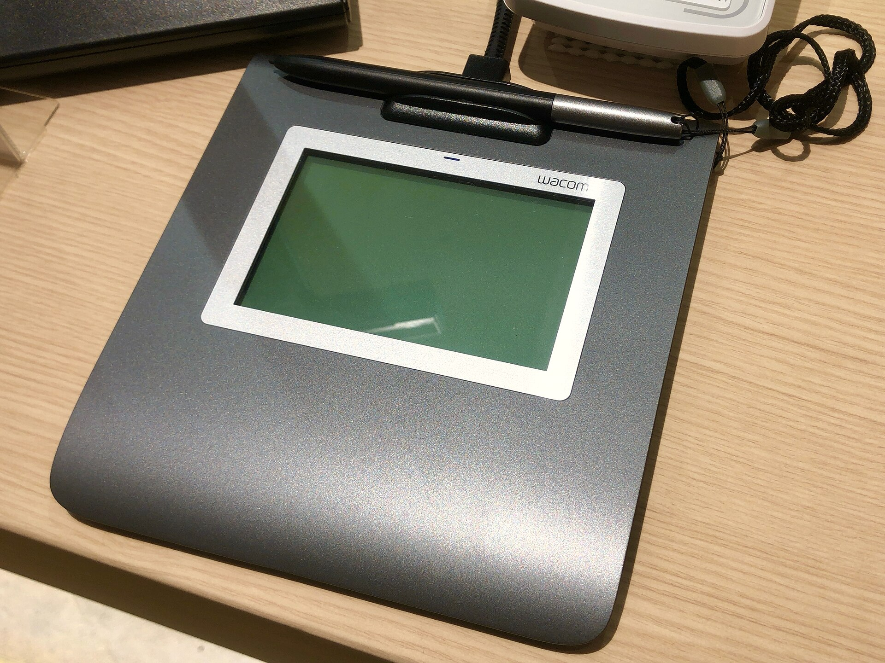

A company that sends ten contracts a week and a freelancer who signs two a month are not buying the same thing. Both will see the names DocuSign, Adobe and Zoho in search results. Neither will find a clear answer to the question that matters in Nepal: if I sign this way, will the signature count?

This post puts the prices we could read next to what the Electronic Transactions Act, 2063 actually says, then places each option on that ground. Prices were checked on 20 October 2026. For the signing mechanics see [how to sign a PDF with a digital signature in Nepal](/blog/sign-pdf-digitally-nepal), and for what Nepal's certificates cost see the [certificate price comparison](/blog/digital-signature-certificate-price-nepal).

## What these services sell

A signing service is a workflow. You upload a document, name the people who must sign, and the service emails them, collects the signatures, keeps a record of who did what and when, and returns the finished file. What it applies to the PDF at the end differs by service and by plan.

- **A drawn or typed signature with an audit trail.** The mark is an image. The proof is the log. The [digital versus electronic signature post](/blog/digital-signature-vs-electronic-signature) explains why that is a weaker thing than a digital signature.
- **A certificate-based signature made with a certificate the service controls.** The signature is real cryptography, and its certificate was issued by the service's own authority.
- **A certificate-based signature made with a certificate the signer holds.** The service is the courier. The key and the certificate come from elsewhere, for example from a certifying authority in the signer's country.

Most legal questions in Nepal come down to which of the three you are using.

## What the Act says, and does not say

Everything below is from the English text of the Electronic Transactions Act, 2063, which [Radiant CA hosts](https://radiantca.com.np/assets/nav_file/Electronic%20Transaction%20Act%202063.pdf). We cite sections. We do not add anything the text does not say.

**The Act recognises a digital signature, and defines it narrowly.** Section 2(o) defines a digital signature as a signature in electronic form, made through a type of asymmetric crypto system, that can clearly tell you two things. First, whether the transformation of the electronic record was made with a private key consistent with the signer's public key. Second, whether the original record has changed since. Section 3 says a subscriber may authenticate an electronic record with a personal digital signature, and that the record is transformed by an asymmetric crypto system and a hash function. Anyone may verify it with the subscriber's public key.

**It gives that signature legal effect.** Section 5 says that where the law requires a document to be signed, a document certified by digital signature "after fulfilling the procedures as stipulated in this Act or the Rules made hereunder" shall also have legal validity. Section 4 does the same for electronic records where the law requires writing.

**It controls who may issue the certificate.** Section 30 says only a licensed or recognised certifying authority may issue a digital signature certificate. Section 15 forbids anyone to act as one without a licence. Section 23 lets the Controller, with the Government's prior approval and by notice in the Nepal Gazette, recognise a foreign certifying authority, which may then issue certificates under the Act throughout Nepal.

**It does not use the words electronic signature.** We searched the whole text. The phrase does not appear. The only signature the Act defines and gives effect to is a digital signature. That is not the same as saying a drawn or typed signature is invalid. It means the Act is silent on them, and whether such a mark satisfies a given law is a question for that law and for the document, not something this Act answers.

**It has a rule about whose message an electronic record is.** Section 10 says an electronic record is attributed to the originator if the originator sent it, if a person with authority to act for the originator sent it, or if it was sent through an information system that the originator programmed to operate automatically. It is general. It does not mention signing services.

**It lists what the Act does not cover.** Section 77 says the Act does not apply to:

- negotiable instruments under the Negotiable Instruments Act, 2034;
- a deed of will, mortgage, bond, conveyance, partition, or any such deed related to transfer of title in immovable property;
- any other document that shows title or ownership in immovable property;
- a power of attorney, statement of claim, statement of defense or other document used in court proceedings;
- statements of claim, counter-claim, statement of defense or other written documents in arbitration;
- documents the prevailing law requires not to be kept in electronic form.

We discuss this list in [documents you cannot sign digitally in Nepal](/blog/documents-not-signed-digitally-nepal). The point for this post is simple. No service, at any price, makes a will or a land transfer deed signable under this Act.

### Who is licensed

As [we found in the price comparison](/blog/digital-signature-certificate-price-nepal), the only certifying authority on the national root's list of CA certificates is Radiant InfoTech Nepal. We found no licence list and no recognition notice for any foreign authority, but we could not search the Nepal Gazette, so absence in our search is not proof of absence. Treat "no recognised foreign provider" as unproven.

## DocuSign: prices

The numbers below are what [DocuSign's plans page](https://ecom.docusign.com/plans-and-pricing/esignature) showed on 20 October 2026, under "Annual, billed monthly". Taxes may apply, the page says. DocuSign's page also carries a banner about saving up to 33 percent, which refers to a billing choice we could not see in what we read.

| Plan | Price shown | Annual commitment | Envelopes | For |
|---|---|---|---|---|
| Personal | US$11 a month | US$132 | 5 per month | Individuals and sole proprietors |
| Standard | US$30 per user per month | US$360 | 100 per user per year | Small to medium teams |
| Business Pro | US$45 per user per month | US$540 | 100 per user per year | Teams that automate agreements |
| Enhanced | Contact sales | Not shown | Custom limit | Larger needs |

An envelope is one signing transaction: a document or set of documents sent to its recipients. The number matters more than the price per month. On the arithmetic, and these are our figures, not DocuSign's: if you used every envelope, Personal costs about US$2.20 each (US$132 over 60), Standard US$3.60 (US$360 over 100) and Business Pro US$5.40 (US$540 over 100). Send fewer and each one costs more.

What changes between plans, according to the page:

- **Personal** has signing workflows, reminders, templates, an audit trail and a mobile app. The comparison table marks branding, commenting, scheduled sending, in-person signing, pre-filled fields and a value calculator as not included.
- **Standard** adds those, plus team template sharing and delegated signing, with a one-time bonus of 5 SMS deliveries and 5 identity verifications.
- **Business Pro** adds web forms, payments during signing, interactive form fields, real-time data verification and bulk sending.
- **Enhanced** plans are custom: envelope limits, single sign-on, centralised management and 24/7 live technical support.

## DocuSign: how it fits Nepal

On the signature types above, DocuSign's standard envelope falls into the first group: a signing workflow with an audit trail. The Act does not mention that workflow, and the certificate in any signature DocuSign itself applies would come from DocuSign's side, not from a Nepal certifying authority. Section 30 speaks of certificates from a licensed or recognised authority.

There is a second route in DocuSign's own terms. Its [Digital Signature Service attachment](https://www.docusign.com/legal/terms-and-conditions/digital-signature) says a signer may use an existing digital certificate, "stored locally (such as USB or Wallet)", or one from a partnered third-party trust service provider. If that applies to your plan and your token, the certificate could come from Nepal's authority. We did not find a source that says which DocuSign plans include this service, and we did not test a Nepal token. Ask DocuSign before you buy.

## Zoho Sign: prices

[Zoho's pricing page](https://www.zoho.com/sign/pricing.html) fills in its prices with a script, so the text on the page has no numbers. The page reads them from a data file, and we read that file. It lists several currencies. We used the US dollar set. Which currency a visitor from Nepal is shown depends on Zoho's own rules, so confirm on the page.

| Plan | Monthly billing | Yearly billing | Envelopes |
|---|---|---|---|
| Free | US$0 | US$0 | 5 per month, single user |
| Standard | US$12 per user per month | US$10 | 25 per user per month |
| Professional | US$20 | US$16 | Unlimited |
| Enterprise | US$28 | US$22 | Unlimited |
| Custom | Quote | Quote | Flexible, for API volume |

The page says "Yearly - Save 20%", and the numbers fit: US$10 against US$12 for Standard. We have assumed the figures are per user per month, because the Standard envelope allowance on the page is stated per user per month. A Zoho paid plan also draws on credits for some features. The page marks these as consuming credits: SMS delivery, advanced and qualified signatures, recipient authentication by ID or knowledge questions, document timestamping and stamp duty payment, among others.

Features that matter here, as listed on the page:

- **Free:** "Sign using Zoho's DSC", described as cloud-based digital signature certificates issued to Zoho.
- **Standard:** "Sign using non-Zoho DSC", described as using your own digital signature certificates from USB tokens and PFX files. Also OTP, government ID and other recipient authentication, delegated signing and an AI field detection feature.
- **Professional:** unlimited envelopes and templates, branding and reports.
- **Enterprise:** bulk send, in-person signing, APIs and webhooks, and Qualified Electronic Signatures (listed as consuming credits).

## Zoho Sign: how it fits Nepal

On its face, Zoho is the most direct match among the three for someone who already holds a Nepal certificate. The Standard plan lists signing with your own certificate from a USB token or a PFX file. That keeps the certificate chain in Nepal's hands, with Zoho acting as workflow.

Two caveats. First, the feature is described in one line on a pricing page. Whether a Nepali token driver works in Zoho's flow, and whether the finished PDF carries the signature in a form a Nepali reader recognises, is something to test with a trial. The Free plan lets you try the workflow, and Zoho offers a 14-day trial of paid plans. Second, the Free plan's certificate is issued to Zoho. The same reasoning as for DocuSign applies: it is not a certificate from a Nepal certifying authority.

## Adobe Acrobat and Acrobat Sign

We could not read Adobe's prices. Adobe's pricing pages render figures with a script, and Adobe's servers refused our automated requests for the pages with the plan details. A saved copy of its [plans page](https://www.adobe.com/acrobat/plans.html) shows only placeholders where the prices should be. Third-party sites quote different figures for the same plans, so we do not repeat them. Open Adobe's page in a browser and read the figure for your country.

What we can say from what we read:

- Adobe's [comparison page](https://www.adobe.com/acrobat/pricing/compare-versions.html) names three plans: Express, Standard and Pro. It also sells Acrobat Pro 2024 as a desktop-only product for a one-time payment covering a three-year term.
- For the plain task of signing a PDF with a Nepal certificate, you do not need a paid plan. The manuals Nepal Certifying Company publishes use Acrobat Reader DC with a USB token, and its multiple signing manual says that for others to sign in Reader, the PDF first has to be reader-enabled in Acrobat DC 2023. The steps are in [our signing guide](/blog/sign-pdf-digitally-nepal).
- We read nothing about Acrobat Sign's plans, its envelope limits, or whether it reaches a Nepal-issued certificate. We make no claim about it.

## Local signing: a Nepal certificate and a reader

This is the route in which the certificate comes from a Nepal authority, and the Act's section 30 is plainly satisfied.

- **Token and Acrobat Reader or Foxit.** The certificate is on a USB token. The price depends on class and validity. On the lists we read, a Class 2 individual certificate for one year is Rs 3,000 with a token, plus government taxes. Software can be free. [The price comparison](/blog/digital-signature-certificate-price-nepal) has every row.
- **Phone app.** The ePahichan app creates your signing key on your phone, keeps it in the phone's secure hardware and unlocks it by fingerprint or face. You can send a document to several people and see who has signed. The certificate is issued by Nepal Certifying Company, and the fee is shown in the app before you pay. We do not publish a price here.

What local signing does not give you is the convenience layer that the cloud services sell: reminders, templates, a polished signer experience for outsiders and an integration with your CRM. It gives you the certificate and the validity.

## Putting them side by side

| | DocuSign | Zoho Sign | Acrobat desktop | Local with token | ePahichan app |
|---|---|---|---|---|---|
| Entry price we could read | US$11 a month (Personal) | Free, then US$10 or US$12 per user per month | Reader free. Paid plans not read | Certificate from Rs 1,200 (Class 1, one year, plus token) | Fee shown in app |
| Envelope or volume limit | 5 a month, then 100 per user per year | 5 a month, 25 a month per user, then unlimited | None | None | Not published |
| Certificate from a Nepal authority | Only via signer-held certificate, plan eligibility unconfirmed | Standard and above, with your own token or PFX | Yes | Yes | Yes |
| Workflow for several signers | Yes | Yes | Limited. Manual process | Manual | Yes, in the app |
| Fit with section 30 of the Act | Depends on which certificate | Depends on which certificate | Satisfied if the certificate is from a licensed authority | Satisfied | Satisfied |

The Class 1 figure in the local column is NCC's list price of Rs 1,200 before the token, and it is not what you pay in total. The [price comparison](/blog/digital-signature-certificate-price-nepal) shows the token-inclusive Rs 2,400.

## How to choose

Ask three questions in this order.

**1. Is the document one the Act excludes?** If it is a will, a property deed, a power of attorney or a court paper, stop. Section 77 takes it out of the Act. See [documents you cannot sign digitally](/blog/documents-not-signed-digitally-nepal).

**2. Who will rely on the signature, and what do they expect?** A bank, a government office or a court will tell you what it accepts. Ask in writing. If the answer is "a digital signature from a licensed certifying authority", a drawn mark in a cloud service does not meet it, whatever the service costs. If the answer is "any electronic signature", a cloud workflow may be enough, and it is quicker. The [OTP versus digital signature post](/blog/otp-or-digital-signature-loan-disputes) shows how a dispute turns on that choice.

**3. How many documents, and who signs them?** For a handful a month, a certificate and a free reader cost less than any plan above. For many outside signers on a schedule, a workflow service saves real time, and you can ask whether it applies a certificate you already hold.

## What we could not verify

- Adobe's current prices for Acrobat plans, and anything about Acrobat Sign.
- Which DocuSign plans include signer-held certificate signing, and whether a Nepal token works with it.
- Whether any foreign certifying authority has been recognised in the Nepal Gazette under section 23.
- DocuSign's price under annual prepaid billing, which the page's savings banner points to.
- Whether the Zoho figures we read in its data file are the ones shown to a visitor from Nepal.
- How Nepali courts or regulators treat a click-to-sign workflow. The Act is silent, and we found no source that answers.
