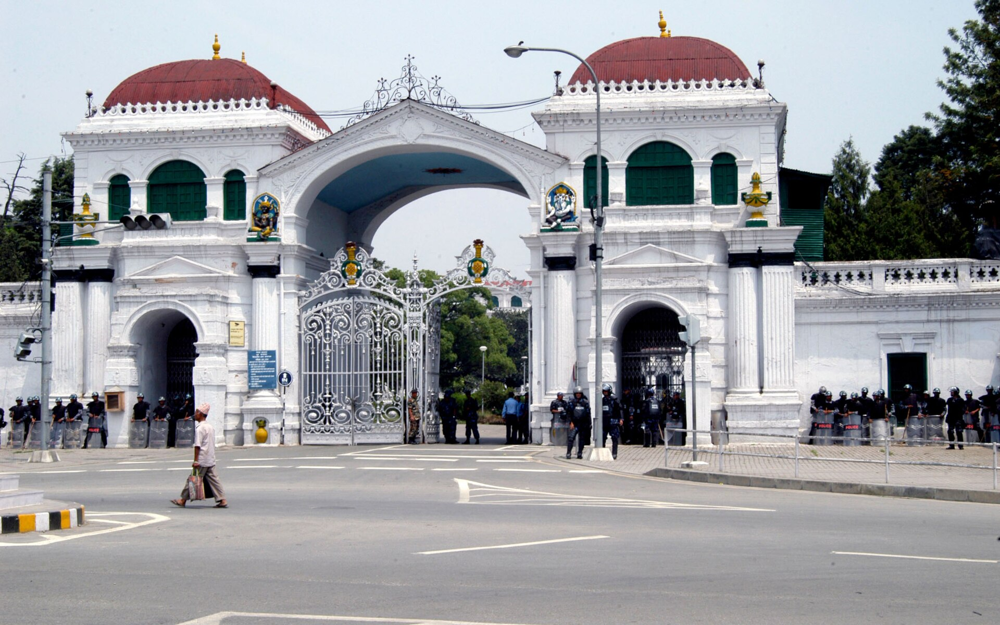

If you want to sell to the Government of Nepal, you will probably end up on one website: the e-GP portal run by the Public Procurement Monitoring Office (PPMO). Many contractors and suppliers ask the same question before their first bid. Do I need a digital signature certificate?

We went looking for the answer in official documents. The official answer is not the one the private guides give. This post lays out what PPMO's own booklet and real bidding documents say, what they leave out and where the two accounts disagree, so you can check your own tender against it.

For what a digital signature certificate is and who sells one, see [what a digital signature is worth in Nepal](/blog/what-is-a-digital-signature-nepal) and [the certificate price comparison](/blog/digital-signature-certificate-price-nepal).

## What e-GP is

e-GP is Nepal's national electronic government procurement portal. According to PPMO's [e-GP booklet](https://dor.gov.np/home/publication/ppmo/force/egp-booklets-all), a copy of which the Department of Roads hosts, a 2011 amendment to the Public Procurement Regulations made PPMO responsible for operating a single national e-GP portal, and said public entities should carry out their procurement transactions through it. The 2013/14 budget speech then told public entities to use e-GP for procurement above NRs 6 million.

The booklet says the second phase of the system was developed between September 2013 and December 2015 and rolled out from 1 January 2017 to all public entities, including local level agencies. It covers procurement from planning to contract management. An [Asian Development Bank note](https://www.adb.org/publications/instituting-e-government-procurement-nepal) from June 2016 dates PPMO's approval of the rollout to December 2015 and says ADB supported the work from 2012.

The portal's address in every notice we read is www.bolpatra.gov.np/egp. On 20 October 2026, when we checked, the home page showed a System Under Maintenance screen with a link to an official notice. We could not open that notice, so we do not know the reason or the duration. If you are reading this to prepare a bid, check the site again before you plan around it.

## How you register as a bidder

The booklet's section on bidder registration is short and specific. A bidder visits the e-GP site and fills in personal and organisational details with supporting documents. The booklet names three: the firm or company registration certificate, the tax registration certificate and a power of attorney. A super user has to verify and approve the request. After approval the account is active.

Before you start, the booklet lists two prerequisites. You need a valid email address before you begin, and PDF copies of the supporting documents ready to upload.

The steps, in order:

1. Open the e-GP site and click **Register New User** on the right side of the home page.
2. Fill in the organisation details: country of registration, company registration number and name, category of interest.
3. Fill in your personal details: name, contact details, email address, username, password, and a secret question and answer.
4. Upload the supporting documents and click Register.
5. Open the activation link the system emails you. The booklet says to do this within 10 days of registration.
6. The request goes to PPMO. When the super user approves it, you receive an email confirming registration with your **Bolpatra ID**.

### The profile you must then fill in

Registration is not the end. The booklet says it is mandatory for the bidder to update the profile with organisation, personnel, financial and contract details, including work executed, litigation, equipment and other documents. It lists the profile tabs: organisation, personnel (officer and staff details), financial details (balance sheet, income statement and average annual turnover), contract details (work executed and in progress), litigation and equipment.

The reason is practical. When you prepare a bid, the booklet says you can reuse this data, such as prior experience, key experts, equipment and financial situation. Bids for joint ventures need more: all partners must be registered and must have managed their profiles, and the lead bidder invites partners by Bolpatra ID.

A guide from a private bidding site adds some details that we could not confirm from official sources, such as processing times and a tax clearance age limit. We have not used them. Ask PPMO or read the current e-GP help documents. Both the manual links in the booklet currently lead to the maintenance page.

## What it costs

### Registration

The booklet's registration steps mention no fee at any stage. Several private guides say registration is free. An official statement that says "registration is free" is something we did not find, so read the absence of a fee in the steps as an absence, not as a promise.

### Per tender

The charges that do appear are attached to individual tenders. They are set by the public entity running the tender, and they are written into its invitation for bids.

| Notice | Year | Bid document fee | Bid security |
|---|---|---|---|
| Karmachari Sanchaya Kosh, modular data center | 2022 | Rs 3,000, non-refundable | Not less than Rs 2,40,000, cash or bank guarantee |
| DUDBC construction bid (published 2076/02/06 BS) | 2019 | Rs 3,000 | Not read |
| Herbs Production and Processing Co., camphor supply | 2019 | Rs 5,000 non-refundable, till 10-09-2019 | Not read |
| Nepal Rastra Bank, furniture and fixtures (No: NRB/GOODS/NCB/08/082/83) | May 2026 | Rs 10,000, non-refundable | Not less than Rs 19,00,000 |

The DUDBC row is from the [DUDBC bidding document](https://bolpatra.gov.np/egp/download?alfId=c81273b9-e6fa-4569-99b1-3abf184be0c9&docId=61742631), the 2022 row from [the KSK bidding document](https://bolpatra.gov.np/egp/download?alfId=cm:Bidding_Documentsnull/cm:Y2022/cm:M5@@@@@87d5a05f-e858-4b43-b9dc-af47349bf8a1&docId=72354338), and the latest row from the [Nepal Rastra Bank invitation for bids](https://www.nrb.org.np/contents/uploads/2026/05/For-Add.pdf), published 27 May 2026. The figures differ because each public entity sets its own.

How you pay matters as much as how much. The booklet says bidders may have to visit banks when a bid document fee or a bid security is a prerequisite. The bidder pays offline, then uploads the bank voucher or the bid security document in the system under Procurement Execution, then Fee/Security, then Process. The Nepal Rastra Bank notice makes the same point: a scanned copy of the bid security, in PDF, goes with an e-bid.

> [!TIP]
> Fund the bank deposit before the last day. You cannot finish an e-bid without the voucher, and an office queue is not a reason the system will wait.

## What goes into a bid

The standard bidding documents that PPMO issues list what an electronic bid must contain. We read the table in a 2022 document. Your tender may differ, so treat it as an example of the pattern, not the rule.

| Document | Requirement | Form |
|---|---|---|
| Letter of Bid | Mandatory | PDF or web form |
| Bid security (bank guarantee) | Mandatory | PDF |
| Company registration | Mandatory | PDF |
| VAT registration | Mandatory | PDF |
| Tax clearance certificate, or evidence of tax return submission | Mandatory | PDF |
| Power of attorney of bid signatory | Mandatory | PDF |
| Bank voucher for cost of bid document | Mandatory | PDF |
| Joint venture agreement | Mandatory for JV bids only | PDF |
| Qualification information | Mandatory | Web form |
| Price adjustment table | Mandatory | Web form |
| Completed BOQ | Mandatory | Web form |

The note under that table matters most. It says documents marked Mandatory should be included in the e-submission, and that failing to submit them is treated as a non-responsive bid. In plain words: leave out the tax clearance and your price will not be read.

A later document in the same family, a sealed quotation form, lists the same items in a shorter list. It includes "Power of Attorney of Bid signatory (Mandatory)" and "Bank Voucher for cost of bid document (Mandatory)". The pattern repeats across the bidding documents we read from 2019 and 2022.

Notice the word signatory. The person who signs the bid for the firm must be authorised, and the authority is a document, a power of attorney, uploaded as a PDF. It is a paper idea carried over into PDF. The signature on the Letter of Bid is whatever the document prescribes. We found no instruction in any of them to sign with a certificate.

## How the system checks who you are

The booklet describes the final step of submitting a bid. After filling in the bid and downloading the bid response report to check it, the bidder clicks **Generate OTP**. A system generated OTP code is sent to the email address of the user. The bidder enters it to submit.

The bidding documents say the same thing in the instructions. Three 2019 documents we read, PPMO's standard sealed quotation document, a DUDBC construction bid and a bid to supply camphor, carry an instruction along these lines: for verifying the authentic user, the system sends a one time password to the registered email address of the bidder, and the system validates it before letting the bidder submit. The 2022 documents we read describe the same register, download, prepare and upload flow without repeating the OTP line, and the 2026 notices are invitations that do not go into it.

The booklet adds that the bid response and sensitive bidding data are encrypted in the system, and that the bidder can modify or withdraw a bid before the deadline.

This is a different kind of identity check from a digital signature. A one-time password proves that whoever submitted the bid can read the registered email inbox. It does not bind the person to the exact bytes of a document in a way that anyone can verify later. [Our OTP versus digital signature post](/blog/otp-or-digital-signature-loan-disputes) explains the difference. For e-GP, the consequence is that your email account is a key. Treat it like one.

### Submitting, changing and withdrawing

- A bid can be modified several times online before the deadline. The standard document says so directly.
- Once a bid is withdrawn, the bidder cannot submit another response for the same bid.
- The system will not accept a bid after the deadline. The standard time is Nepal Standard Time.
- If the last day for purchase or submission falls on a government holiday, the notices we read say the next working day applies, with the validity of the bid and bid security unchanged.
- PPMO's standard sealed quotation document says that once a quotation is submitted the bidder cannot modify or withdraw it. That is stricter than the bid rule above. Read the instructions for the tender you are bidding on.

## So where would a digital signature certificate come in?

The honest position is that we found one source of confusion and no source of a requirement.

**What says it is needed.** Two private guides mention digital signatures in connection with e-GP. One, a bidding site's guide dated 10 September 2026, says a certificate from an authorised certifying authority is needed for e-bidding enabled tenders, that registration does not need one and that bid submission does. Another site's guide lists a "Bolpatra account" with "digital signature credentials" as a requirement for the vendor profile. Neither points to an official PPMO document.

**What says it is not.** The PPMO booklet describes registration, profile, bid preparation and an email OTP, with no mention of a digital signature certificate. The bidding documents we read, from 2019 and 2022, set out the e-submission steps in detail, and three of them include the same OTP step. None mentions a digital signature, and neither do the two 2026 invitations from Nepal Rastra Bank. A bidding document would be the natural place to say a certificate was needed.

**What we could not read.** Many recent notices tell bidders to follow the Electronic Procurement System Operation Directives, 2080 issued by PPMO. That is the document that would settle the matter, and we could not retrieve it. PPMO's site also carries notices about the e-GP system and a help desk, but their contents are attachments we could not open.

The practical rule follows. Do not buy a certificate on the strength of a guide. Open the bidding document for the tender you want, read the section on electronic submission, and see whether it names a certificate. If it does not, ask PPMO's e-GP help desk before you spend money.

### Where the law leaves room for one

The Electronic Transactions Act, 2063 does contemplate government offices accepting digital signatures. [Section 41](https://radiantca.com.np/assets/nav_file/Electronic%20Transaction%20Act%202063.pdf) lets the Government of Nepal, where a signature is required on a document issued or accepted by a government agency, a public entity or a bank, make a provision to use a digital signature instead. The [Rules, 2064](https://radiantca.com.np/assets/nav_file/Electronic%20Transaction%20Rules%202064.pdf) go further in rule 37. A government agency that wants to accept documents in electronic form has to publish a notice and disclose the electronic address. Documents sent with a digital signature to that address are deemed received.

The Act therefore allows a procurement office to require or accept a digital signature. It does not, by itself, say that every e-GP bid needs one. A requirement has to come from PPMO, in its directives or in your tender.

### A power of attorney is not a digital document

One small trap is worth knowing. The power of attorney of the bid signatory is a mandatory upload. Under the Electronic Transactions Act, certain instruments cannot be made by digital signature at all, and a power of attorney is among those on the list our site summarises. See [documents you cannot sign digitally in Nepal](/blog/documents-not-signed-digitally-nepal). So the power of attorney in an e-bid is a normal signed paper document, scanned to PDF, not a digitally signed file.

## Mistakes that cost bids

None of these needs a certificate. All come straight from the official documents.

1. **Leaving out a mandatory document.** The standard document calls this non-responsive.
2. **A joint venture partner who has not finished their profile.** All partners must be registered and have updated profiles. Consent is given through a link sent to each partner's registered email, and each partner must acknowledge it.
3. **No bank voucher.** The bid fee voucher is itself a mandatory upload where a fee applies.
4. **Waiting for the last hour.** The system will not accept a bid after the deadline, and the activation link in registration lasts 10 days.
5. **Not reading the specific tender.** The Instructions to Bidders in each document differ in the details. The sealed quotation standard says a quotation cannot be changed after submission. The bidding documents say bids can be modified until the deadline.

## What this means for a business that signs

If you only bid, you can register today without a certificate, according to the official papers we read. If you plan to sign contracts with public entities, the picture is different. A contract is the document where a binding signature matters, and public bodies may start asking for digital signatures there. The Act allows it. Prepare by getting your organisation's authority documents in order, and by deciding who in your company will hold a certificate. [Why the key should never be shared](/blog/how-to-get-digital-signature-certificate-nepal) applies here as much as anywhere.

## What we could not verify

- The Electronic Procurement System Operation Directives, 2080, and any digital signature provision in them.
- The reason for the maintenance screen on the e-GP home page, and its duration.
- A current, official statement on whether registration has a fee or needs renewal.
- The PPMO help documents linked from the booklet. They returned the maintenance page.
- Whether any tender asks bidders for a certificate. We read a sample of bidding documents from 2019 and 2022 and two 2026 invitation notices, not every tender.
