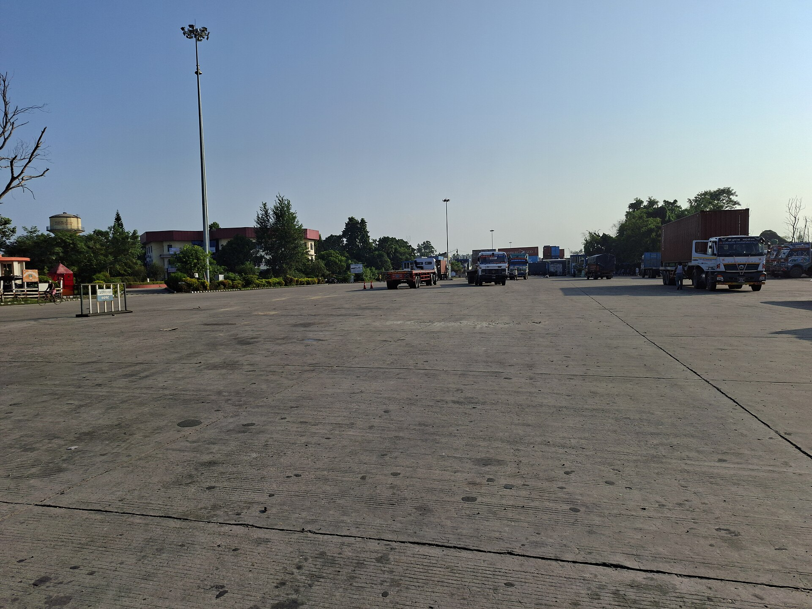

If you run a business in Nepal, three government systems touch you more than any others: the Inland Revenue Department (IRD) for tax, the Office of the Company Registrar (OCR) for the company itself, and the Department of Customs for anything that crosses the border. A common question is whether you need a digital signature certificate to deal with them.

We checked each office's own pages, notices and the text of the Electronic Transactions Act, 2063. The honest answer is more specific than yes or no. The law makes room for digital signatures in government work. The three offices differ a lot in how much they use one today. And where we could not confirm something from an official page, we say so rather than guess.

If you need the basics first, read [what a digital signature is and what it is worth in Nepal](/blog/what-is-a-digital-signature-nepal).

## What the law says about filing electronically

The starting point is the Electronic Transactions Act, 2063. Its English text, hosted by the [UNODC legal library](https://sherloc.unodc.org/cld/uploads/res/document/the-electronic-transactions-act-_html/Nepal_Electronic_Transactions_Act.pdf), has four provisions that matter here.

**Section 5** says that where a law requires a document to be signed, a digital signature made under the Act and its Rules also has legal validity. **Section 4** does the same for records that must be in writing. **Section 39(2)** says that where a law provides for filing a form, getting a licence, or paying money at a government agency, public entity, bank or financial institution, it may be done in electronic form, and the filing cannot be denied validity only because it is electronic.

Then comes the limit. **Section 40(1)** says a government agency, public entity, bank or financial institution "may also accept" documents and payments in electronic form. **Section 40(2)** adds that, except in conditions and for agencies prescribed, none of them can be compelled to accept an electronic document or payment. **Section 41** says that where a person must sign a document for a government agency or bank, the Government of Nepal "may, if it thinks appropriate" provide for a digital signature instead, and may prescribe extra security procedures.

Put plainly:

| Section | What it does | Effect on a business |
|---|---|---|
| 4 and 5 | Electronic records and digital signatures can satisfy writing and signature requirements | A digital signature is legally valid where a signature is required |
| 39(2) | Filings, licences and payments may be made electronically | An electronic filing cannot be rejected for being electronic alone |
| 40 | Agencies and banks may accept electronic documents, but are not compelled | Each office decides what it accepts, within the Rules |
| 41 | Government may allow digital signatures in place of signatures | The office, not the law, decides when a certificate is needed |
| 77 | The Act does not apply to some documents | Powers of attorney, land deeds and a few others stay on paper |

So the Act is permission, not a mandate. What you need to sign in with at IRD, OCR or Customs is set by each office. We explain Section 77 in [which documents cannot be signed digitally in Nepal](/blog/documents-not-signed-digitally-nepal).

## Inland Revenue Department

The IRD runs its filing through the [taxpayer portal](https://taxpayerportalb.ird.gov.np/), which links from the IRD home page at [ird.gov.np](https://ird.gov.np). The portal's own page lists what it handles: registration for PAN, VAT and excise, VAT returns, estimated tax returns, income tax returns in forms D-01 to D-04, excise returns and several fee returns. It lists a separate login for each. The page text does not mention a digital signature step.

The [IRD FAQ page](https://ird.gov.np/faq/) is more direct about access. For paying tax electronically it says the service is available only to taxpayers who hold a username and password obtained by self-verification of their details at an IRD office. It also says the taxpayer must register through ConnectIPS, the service run by Nepal Clearing House, and link a bank account.

That matches how most Nepali businesses file in practice: a username, a password and a bank link, not a certificate on a USB token.

A commercial guide to [monthly VAT filing](https://www.nepaldatabase.com/monthly-vat-return-filing-in-nepal-2026-a-practical-guide-for-smes-using-the-ird-efiling-portal) says a business needs either a username and password or a digital signature certificate issued by IRD, and that the return is due by the 25th of the following month. We found nothing on the IRD pages we could read that describes an IRD-issued certificate, so treat that line with caution and ask your tax office.

In August 2026 the IRD upgraded the portal. [Nepal News reported](https://english.nepalnews.com/s/business/inland-revenue-department-launches-upgraded-taxpayer-portal/) on 25 August 2026 that taxpayers can now correct VAT filing errors online within seven days, self-verify monthly excise records, and have certain income details filled in automatically. Online PAN registration for foreign investors is included, and e-TDS now tracks entries in real time so that deductions cannot be back-dated. The report says the system was to run a one-month trial before full deployment. None of this is described as needing a digital signature.

### What we did not find

We found no IRD notice that requires a digital signature on a return, on an invoice, or on a tax clearance request. The IRD home page also has a section for electronic invoices. We did not open every notice there, and none of the titles we saw mentions signatures. If your accountant tells you a certificate is mandatory, ask for the notice number.

## Office of the Company Registrar

Company registration is done through the OCR's online system, CAMIS. The OCR home page at [ocr.gov.np](https://ocr.gov.np) links to the login at camis.ocr.gov.np and to a series of notices about CAMIS improvements, system downtime, fine payment through CAMIS, and a help desk form. It also carries a link, repeated on every notice page, that says (in Nepali) that anyone who has a problem with the National ID should fill in a form.

That link is the clearest official sign that identity in CAMIS is tied to the National ID. Some law-firm guides state flatly that a National ID number is mandatory for every promoter since 2082 BS, but those are secondary sources and we could not open the OCR notice that would settle the date and scope. See our explainer on the [National ID card](/glossary/national-id-card) and the [NIN](/glossary/nin).

The OCR's [registration page](https://ocr.gov.np/pages/registration/) sets out the documents for a company with Nepali promoters: an application in the prescribed schedule form, the memorandum of association in two copies, the articles in two copies, certified copies of the promoters' citizenship certificates, and any prior agreement among promoters. A digital signature is not on that list.

### The fee schedule

The OCR [revenue page](https://ocr.gov.np/pages/revenue) publishes the fee under a notice in the Nepal Gazette dated 2064/02/14. For a private limited company, the fee depends on authorised capital:

| Authorised capital | Registration fee, private company |
|---|---|
| Up to Rs 100,000 | Rs 1,000 |
| Rs 100,001 to Rs 500,000 | Rs 4,500 |
| Rs 500,001 to Rs 2,500,000 | Rs 9,500 |
| Rs 2,500,001 to Rs 10,000,000 | Rs 16,000 |
| Rs 10,000,001 to Rs 20,000,000 | Rs 19,000 |
| Rs 20,000,001 to Rs 30,000,000 | Rs 22,000 |

The schedule continues in steps of Rs 3,000 per Rs 10 million up to Rs 100 million, and Rs 30 per Rs 100,000 above Rs 100 million. Public companies pay Rs 15,000 up to Rs 10 million of capital, Rs 40,000 up to Rs 100 million, and more above that. A foreign company's branch office pays on proposed investment, from Rs 15,000, and a liaison office pays Rs 50,000 as a lump sum. A company that distributes no profit pays Rs 15,000.

Two warnings. The same page lists a Gazette notice dated 2080/6/8 that gave full exemption from registration fees for private and public companies for fiscal year 2080/81. And the OCR home page lists a press release dated 2083/03/04 about exemption of taxes, fees and fines under the Companies Act, 2063. We could not read what the 2083 notice covers, so check it before you budget.

### Where a digital signature fits around OCR work

The filings themselves go through CAMIS. But a company produces documents around them: board resolutions, shareholder agreements, engagement letters for the company secretary, and employment contracts. Those can be signed digitally under Section 5, with the exceptions in Section 77. See [HR documents and digital signatures](/blog/hr-documents-digital-signature-nepal) for the employment side.

## Department of Customs

Customs is where a digital signature appears on an official page. The Department of Customs page on [its ASYCUDA implementation](https://customs.gov.np/pages/asycuda-system-implementation/) describes the Nepal Customs Automation System, NECAS. It is the UNCTAD ASYCUDA World system, which started at the Mechi customs office on 26 January 2016, with the support of the Asian Development Bank. The page says it had been put in place in 28 customs offices. Its list of features includes "Digital signature", next to electronic payment, risk-based selectivity, bar codes and a document upload facility.

The same page describes how it works:

| Module | What it does | Offices |
|---|---|---|
| Goods clearance | The declarant registers the customs declaration (pragyapan patra) in the system, the system calculates the duty, banks collect it and issue a bank receipt, and an exit note is issued | 28 |
| Gate entry | Vehicles entering the customs area are recorded. A declaration is assessed automatically only once gate entry and declaration both match | 23 |
| Selectivity | Declarations are routed by risk to a red, yellow or green lane under Section 20 of the Customs Act, 2064 | 26 |
| Manifest | Airlines' manifests arrive electronically, so assessment can begin before the goods land | Tribhuvan airport |
| Bank guarantee | A guarantee must be entered and verified before a declaration is filed against it | not stated |

Red means documents and physical inspection, yellow means documents only, and green means neither. Declarations, bank receipts and exit notes print with bar codes.

What the page does not say is who signs with a certificate, how it is issued, or whether it is mandatory for customs agents. A 2013 UNESCAP presentation we found in search results was blocked when we tried to read it, so we do not cite it. If you are a customs agent or importer, ask the customs office where you file what is required today, and read the [customs agent forms](https://customs.gov.np/content/96/customs-agent-renewal-form/) the department publishes.

The [department's home page](https://customs.gov.np) carries current notices, including changes to customs points, so check it for your point of entry.

## A practical summary

| Office | What you sign in or file with | Digital signature on official pages? |
|---|---|---|
| IRD | Taxpayer portal login, with self-verified username and password; ConnectIPS for e-payment | Not described on the pages we read. One commercial guide says a certificate can be used |
| OCR | CAMIS online system, with documents listed on the registration page | Not listed. National ID problems are handled through a form link |
| Customs | NECAS (ASYCUDA World), declarations by registered users | Listed as a system feature. Who must use it is not stated |

## Where a digital signature earns its keep

For the filings themselves, follow what the office tells you. For everything around them, a digital signature does real work.

- **Contracts with suppliers and customers.** These are the documents customs and tax disputes tend to turn on: what was ordered, at what price, delivered where. A signed PDF is tamper-evident and carries the signer's certificate, so anyone can check it later. See [how to check a signed PDF](/blog/how-to-check-a-signed-pdf).
- **Internal approvals.** Board decisions about a tax position or an import can be signed by the directors in turn.
- **Agreements with your customs agent or accountant.** An engagement letter that sets out who is responsible for what is worth having in a form nobody can quietly edit.

Do not use it for documents that Section 77 excludes. Powers of attorney, deeds that transfer title to immovable property, negotiable instruments and court or arbitration pleadings stay on paper. A customs agent's authority is something to confirm with the customs office rather than assume.

If you decide to get a certificate, [how to get a digital signature certificate in Nepal](/blog/how-to-get-digital-signature-certificate-nepal) explains who issues one and what to prepare. Only a certifying authority licensed under the Act issues a certificate that carries legal weight here, and [what a certificate authority is](/blog/what-is-a-certificate-authority) explains why that matters.

## A short checklist

1. Ask the office, in writing if you can, what it accepts as a signature. Get the notice number.
2. Do not buy a certificate for a filing the office does not ask you to sign.
3. Keep the username, password and bank link for IRD and CAMIS with the business, not with one employee or consultant.
4. Check OCR notices on fee exemptions before you pay a registration fee.
5. Sign contracts and approvals digitally, and keep the signed PDFs.
6. Leave Section 77 documents on paper.

*This is an explanation of public sources, not legal or tax advice. Notices change. Check the office's current page before you rely on anything here.*
