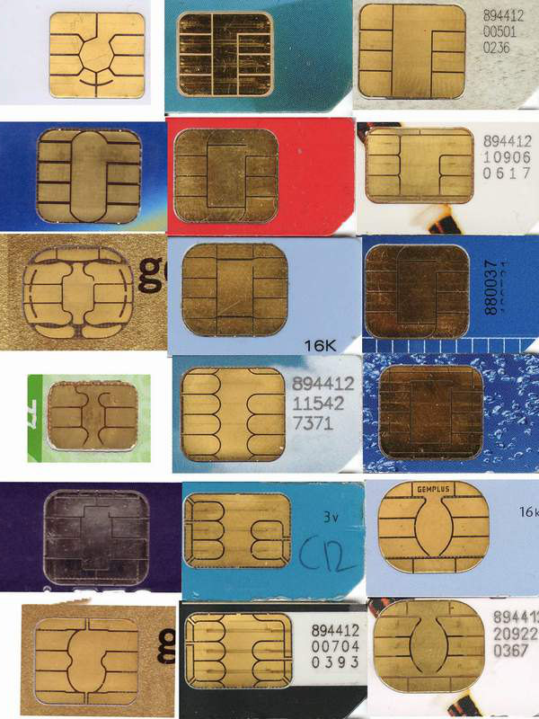

The National ID card is the most talked-about identity project in Nepal, and it gets blamed for a lot. People ask whether it replaces the citizenship certificate, whether the chip can sign a document, and whether it can be used to get a digital signature certificate.

This post sticks to what the official sources say. It uses the Department of National ID and Civil Registration (DoNIDCR), the Controller of Certification's own guidelines, Nepal Rastra Bank notices and dated news reports. Where something is announced but not shown to be live, it says so. For definitions, see our entries on the [National ID card](/glossary/national-id-card) and the [NIN](/glossary/nin).

## What the card is, in the department's words

The department's [FAQ on the National ID](https://donidcr.gov.np/pages/abboyed-asked-questions--rational-identity-10/) answers the question directly. It says the card is a multi-purpose proof of national identity based on smart card technology, with electronic chips and security features, holding a citizen's demographic and biometric details.

The same FAQ lists what is recorded. Personal details include name, date of birth, sex, parents' names, permanent and temporary address, citizenship number and type, spouse, grandparents, nationality and the identity number. The biometric details are ten fingerprints, the iris, a photo and an "electronic signature". That last item is listed with the biometrics, so it reads as a captured signature, not a cryptographic one. The FAQ does not describe a certificate or a signing key.

Other facts from the department's pages:

- You can apply from age 16 with a Nepali citizenship certificate. In the first phase only citizens with certificates are covered. Minors, non-resident Nepalis and foreigners who live in Nepal are named as a second phase.
- The department was set up on 2075/06/28 by merging the National ID Management Centre and the central registration department. The National ID and Civil Registration Act was issued on 2076/10/28. See the department's [introduction page](https://donidcr.gov.np/pages/introduction--national-identity-8).

A smart card chip can hold many things. What it holds on this card is a matter for the department to state, and in the sources we read it describes demographic and biometric data. If you have a technical document that says the chip stores a certificate, we would like to see it.

## How many cards, and how many people

Four different numbers float around, and they are not the same thing.

| Measure | What it counts |
|---|---|
| Enrolment | A person's personal and biometric details have been collected |
| NIN issued | The ten-digit number has been assigned, which can happen before a card is printed |
| Cards printed | The physical card has been produced |
| Cards distributed | The card has reached the person |

Here are the figures with their sources and dates.

| Date | Enrolled | Printed | Distributed or received | Source |
|---|---|---|---|---|
| 21 January 2025 | 16.5 million (1.65 crore) and 16.1 million NINs | over 6 million | not stated | [Online Khabar](https://www.onlinekhabar.com/2025/01/1609248/starting-today-you-can-apply-for-a-passport-through-the-citizen-app-by-obtaining-a-national-identity-card-and-nin-number), citing the registration department's spokesperson |
| Report cited 2 February 2025 | 16.54 million applied | 6.046 million, 5.53 million sent to districts | 1.946 million | [Kathmandu Post](https://kathmandupost.com/national/2025/02/02/supreme-court-clears-way-for-national-id-card-implementation-but-people-continue-to-face-hassles), citing the department's quarterly report |
| Mid-April 2025 | 17,213,550 | 6,235,599 | 2,312,484 received by applicants | [Rising Nepal](https://risingnepaldaily.com/news/61395), 4 May 2025 |
| Falgun 2082 (to mid-March 2026) | 20,013,553 | 7,581,183 | 4,033,040 | [Technology Khabar](https://www.technologykhabar.com/2026/05/27/241610/), 27 May 2026, citing the Economic Survey 2082/83 |

Using the Economic Survey figures, about 38 percent of enrolled people have a printed card and about 20 percent have received one. Biometric Update gave a similar picture in [August 2026](https://www.biometricupdate.com/202608/nepals-national-id-outage-disrupts-passports-banking-and-government-services): about 20 million people enrolled and 7.8 million cards printed.

Why the gap? In February 2025 the department's director general told the Kathmandu Post that cards must be collected in person, and that many printed cards are uncollected. He said it is hard to staff distribution at a daily wage of Rs 600 to Rs 1,200, and that many people are working abroad. Rising Nepal quoted the head of the department's ID management section in May 2025 saying people have not come to collect their cards even though they are printed. The Post adds that the number is issued on the same day as the application, which is enough for many uses.

The same Economic Survey figure says the National ID has been connected to the systems of 12 bodies, including the Department of Passports, the Inland Revenue Department, the Election Commission, social security and the Credit Information Bureau.

## A short timeline of what became live

| Date | Event | Source |
|---|---|---|
| 19 November 2018 | First card distribution, from Phidim municipality in Panchthar | [Rising Nepal](https://risingnepaldaily.com/news/61395) |
| 23 August 2024 | Supreme Court interim order against making NID mandatory for services | [Kathmandu Post](https://kathmandupost.com/national/2025/02/02/supreme-court-clears-way-for-national-id-card-implementation-but-people-continue-to-face-hassles) |
| 14 January 2025 | Banks must verify new customers against NID records and facilitate account opening on the card or its number | [Republica](https://myrepublica.nagariknetwork.com/news/national-id-card-made-mandatory-to-open-bank-accounts-from-january-14-677fe72dafa50.html) |
| 19 January 2025 | Supreme Court dismisses the writ and directs implementation | Kathmandu Post, as above |
| 21 January 2025 | Card can be viewed in the Nagarik App by entering the NIN | [Online Khabar](https://www.onlinekhabar.com/2025/01/1609248/starting-today-you-can-apply-for-a-passport-through-the-citizen-app-by-obtaining-a-national-identity-card-and-nin-number) |
| July 2026 | Wallet providers must verify users against NID records. Existing wallet users to update by end of Ashwin 2083 | [Biometric Update](https://www.biometricupdate.com/202607/nepal-makes-national-id-the-trust-layer-for-digital-payments), [ShareSansar](https://www.sharesansar.com/newsdetail/nepal-rastra-bank-introduces-national-id-requirements-for-digital-wallet-accounts-2026-09-22) |
| Early July to August 2026 | Authentication failures across 13 agencies | [Biometric Update](https://www.biometricupdate.com/202608/nepals-national-id-outage-disrupts-passports-banking-and-government-services) |

The Nagarik App item has detail worth noting. Online Khabar reported that at launch the app carried 62 services from 35 bodies and had been downloaded by about 5.5 million users.

On the bank directive, Nepal Rastra Bank said banks may use electronic means to identify and verify the customer, with access to the electronic record of the citizenship certificate or National ID. It said an account for government social security payments need not be opened on the National ID. A later notice, reported by [Ratopati](https://english.ratopati.com/story/70410/now-the-bank-will-ask-you-for-your-national-identity-card), asks banks to collect a self-declaration of whether a customer has a National ID by the end of Ashwin, and to get the number from those who do. For those who do not yet have a card, it gives six months to the end of Poush. Children under 16 are exempt for account opening. We cover the bank side in [how Nepali banks use digital signatures](/blog/digital-signature-for-banks-nepal).

## What the NID does for digital signing

Here we move from what is documented about the card to what is documented about signing.

### The card is not a signing device, on the sources we have

A digital signature needs a private key that only the signer controls, and a certificate from a licensed certifying authority that ties the matching public key to a named person. We explain the mechanics in [what is a digital signature](/blog/what-is-a-digital-signature-nepal) and [what is a certificate authority](/blog/what-is-a-certificate-authority).

The department describes the chip as holding demographic and biometric data. We found no department page, circular or news report saying the card carries a signing key or a certificate. So today, you do not sign a PDF with the card. You use the card, or the number, to prove who you are to a party that then issues you a certificate, or to a bank that is checking you.

### The Controller's guidelines do give the NID a role in getting a certificate

The Office of the Controller of Certification published its [Identity Verification Guidelines](https://giwmscdnone.gov.np/media/pages/files/identity_verification_guidelines_auyy9zb.pdf), version 1.0, released in June 2022. They bind the licensed certifying authorities and set out how an applicant's identity is checked before a certificate is issued. They give the NID a clear place.

- **Section 2.2, NID eKYC.** The guidelines cover eKYC accounts created from a NID number held in the National ID database. The applicant authorises the certifying authority, through NID eKYC, to obtain demographic data and a photo, digitally signed and encrypted.
- **Online, by OTP.** The applicant submits the NID number and an OTP authentication. The authority then does an interactive video verification and matches the NID photo to the video.
- **Online, by biometrics.** The applicant submits the NID number and a biometric authentication. For each certificate issued, the biometric check must have been done within the last two days, with a face match between the NID photo and the authority's record.
- **Offline.** The applicant uploads a digitally signed eKYC file that they have downloaded, with a share phrase used to encrypt it. The authority decrypts the file, validates the National ID system's signature and extracts the data.
- **Authorisation.** The guidelines say the authority should be an authorised eKYC user agency of the National ID system, with wording "if available and when available".
- **Section 1.4.** It is a requirement for all applicants to present either a PAN or a NID number.
- **Annexure IV.** For a personal certificate, proof of identity can be any one of: NID (eKYC service), passport, driving licence, PAN card, post office ID, a bank statement with photo attested by the bank, a ministry-issued photo ID, or other government photo ID with name and address.

That last list matters. The NID is one accepted route, not the only one. A person with a passport or a driving licence is not shut out.

Elsewhere the guidelines give routes for banking customers, whose bank submits their KYC to the authority directly, and for people who submit a PAN. We use those in the banks post.

### What we could not confirm

The guidelines say what an authority may do. They do not say who is doing it. The phrase "if available and when available" suggests the National ID eKYC service was not yet open to authorities when it was written. We did not find a public notice saying that any certifying authority had been given that access. If a certificate provider tells you it checks you against the National ID, ask whether it is an authorised eKYC agency and by which method.

One caution when you read the guidelines. They name the National ID Management Centre (NIDMC) as the authority, which is the name of the body before the 2075 merger, so read them as a policy framework, not as proof of a running service.

## Announced but not shown to be live

| Item | Status on what we read |
|---|---|
| NID as KYC source for new bank accounts | Live from 14 January 2025, with exceptions and a later declaration drive |
| NID in the Nagarik App by NIN | Live from 21 January 2025 |
| NID checks for digital wallets | Directive issued. Deadline end of Ashwin 2083 |
| One-time KYC through the National ID system | Announced in the monetary policy for 2082/83, reported by [Nepal News](https://english.nepalnews.com/s/business/one-time-kyc-update-now-valid-across-all-banks/). We did not confirm it is running |
| NID as a travel document in India | Nepal has lodged a proposal with India, per Biometric Update in August 2026. No decision reported |
| NID replacing the citizenship certificate | Stated as an eventual aim by the immigration director, per the same report |
| NID eKYC for certificate issuance | Allowed by the Controller's guidelines. Live access by any authority not confirmed |
| A signing key or certificate on the card | No source found |

## Outage in July and August 2026

Biometric Update reported on 3 August 2026, citing the Kathmandu Post, that since early July 13 government agencies including the Department of Passports, banks, tax offices and immigration had trouble authenticating NINs on the National Identity Management Information System. New applicants were getting NINs, but their records were not being approved. Offices were told to continue serving people on enrolment confirmation pages. Banks could not update KYC records because NINs could not be verified. The director general said IT teams and the vendor were working on it, and expected full restoration the following week. We did not find a later report confirming it.

For anyone building a process on NIN lookups, the lesson is plain. Design a fallback, such as a document check, and record which method you used. Our [ID check API](/products/id-check-api) takes a NIN, name, gender and date of birth in Bikram Sambat and returns match or no match. It depends on the national record being available, as any NIN check does. See also [eKYC](/glossary/ekyc) and [liveness detection](/glossary/liveness-detection).

## What to do now

1. **Get your NIN if you do not have one.** Many services now ask for it, and it can be issued on the day you apply.
2. **Use the Nagarik App to carry the card.** You can view it by entering the NIN.
3. **Do not expect the card to sign.** Ask your certificate provider how it will check your identity and which documents it accepts.
4. **Keep your citizenship certificate.** Some offices still ask for a copy next to the NID. See [citizenship certificate](/glossary/citizenship-certificate).
5. **Check dates.** The bank and wallet deadlines fall around the end of Ashwin 2083, and notices may extend them.

*Numbers in this post come from the sources linked. The department's own annual progress report for 2081/82 was too large for us to open, so we use press reports of its data.*
