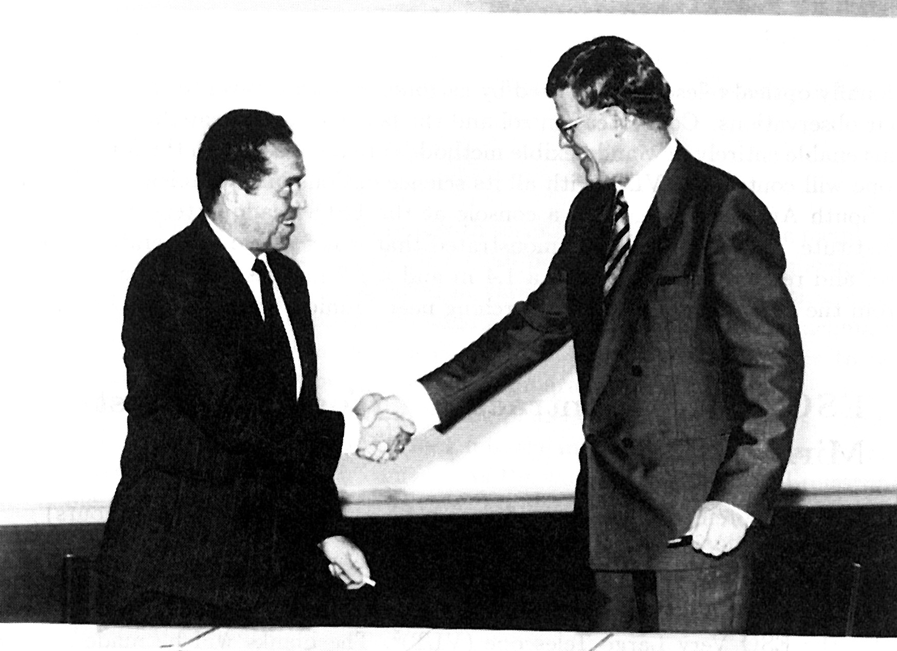
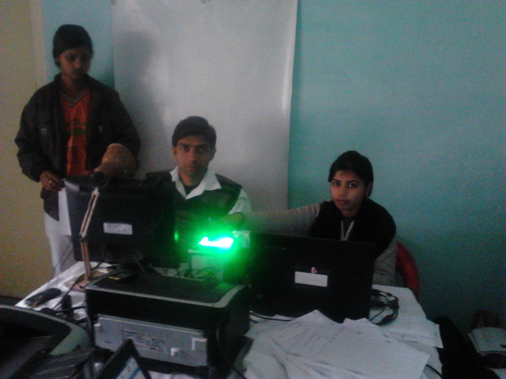

A client in the United States sends a services agreement and asks you to sign and return it. Another, in Germany, wants a signature that "meets eIDAS". A third, in Delhi, says they sign everything with Aadhaar eSign and asks whether you can do the same.

These are three different legal systems asking three different questions. This post goes through each one using the law texts themselves, then shows what a signer in Nepal can actually do. We stick to what the statutes say. We do not give legal advice, and we do not cover which country's law will govern your contract. That choice matters more than the signature type, and it belongs in the contract.

If you are not sure what separates a digital signature from an electronic one, start with [digital signature vs electronic signature](/blog/digital-signature-vs-electronic-signature).

## The short version

| | United States | European Union | India | Nepal |
|---|---|---|---|---|
| Main law | ESIGN Act (federal) and UETA (states) | eIDAS Regulation, No 910/2014 | Information Technology Act, 2000 | Electronic Transactions Act, 2063 |
| Basic rule | Not denied effect only because electronic | Not denied effect or admissibility only because electronic | Electronic signatures satisfy signature requirements, if affixed as prescribed | Digital signature has legal validity, if made under the Act and Rules |
| Strongest tier | None. One flat standard | Qualified electronic signature (equals handwritten) | Digital signature and listed e-signature techniques | Digital signature from a licensed certifying authority |
| Must the other side accept it? | No | Not stated in the Article. Contract law decides | Not stated in the section | Government agencies and banks need not be compelled |
| Certificate needed? | No | Only for qualified and advanced tiers | For digital signatures, yes | Yes, for a digital signature |
| Typical cost | Provider's price | Provider's price | Aadhaar eSign about Rs 25 per signature at one provider | Certificate fee from a licensed authority |

The sections below back each cell with the text.

## United States: any electronic signature, if both sides agree

Two laws sit side by side. The federal Electronic Signatures in Global and National Commerce Act (ESIGN) covers transactions "in or affecting interstate or foreign commerce". A contract with a Nepali company is a foreign commerce transaction. The Uniform Electronic Transactions Act (UETA) is a model law adopted by the states. A 2020 [Washington State Senate bill report](https://lawfilesext.leg.wa.gov/Biennium/2019-20/Htm/Bill%20Reports/Senate/6028%20SBR%20LAW%2020.htm) said 47 states, the US Virgin Islands and the District of Columbia had adopted it, and that New York, Illinois and Washington had not. Check the current position for the state that matters to you.

The operative text is [15 U.S.C. 7001(a)](https://www.law.cornell.edu/uscode/text/15/7001). For a transaction in or affecting interstate or foreign commerce, a signature, contract or other record "may not be denied legal effect, validity, or enforceability solely because it is in electronic form". A contract may not be denied effect solely because an electronic signature or record was used in forming it.

The definition is wide. Under [15 U.S.C. 7006](https://www.law.cornell.edu/uscode/text/15/7006), an electronic signature is "an electronic sound, symbol, or process, attached to or logically associated with a contract or other record and executed or adopted by a person with the intent to sign the record". A typed name can qualify. So can a click. A digital signature with a certificate, which is a far stronger thing, easily qualifies.

Two limits matter for a signer in Nepal.

First, Section 7001(b)(2) says the law does not "require any person to agree to use or accept electronic records or electronic signatures", apart from a government agency in a limited case. A client can still insist on ink.

Second, [Section 7003](https://www.law.cornell.edu/uscode/text/15/7003) lists matters outside the rule. They include wills, codicils and testamentary trusts, adoption, divorce and other family law, and the Uniform Commercial Code other than a few sections. They also include court orders and official court documents, and certain notices, among them notices of default or foreclosure under a credit agreement secured by a primary residence, and the cancellation of utility services or of health or life insurance.

For a typical services or supply agreement none of those apply. The US has no stronger tier of signature, so there is no point shopping for one. If the client accepts a signed PDF, the signature is valid. What it adds when you hold a certificate is evidence: a way to show who signed and that the file has not changed since. See [how to check a signed PDF](/blog/how-to-check-a-signed-pdf).

## European Union: three tiers, and a qualified signature that Nepal cannot issue today

The eIDAS Regulation, (EU) No 910/2014, defines three tiers. We quote the as-adopted text as published on [legislation.gov.uk](https://www.legislation.gov.uk/eur/2014/910/article/3/made), because the EU's own site blocked automated access. The wording of these articles is the text adopted in 2014. Check [EUR-Lex](https://eur-lex.europa.eu) for amendments, including those made in 2024.

| Tier | Definition (Article 3 and 26) | Legal effect (Article 25) |
|---|---|---|
| Electronic signature | "Data in electronic form which is attached to or logically associated with other data in electronic form and which is used by the signatory to sign" | Cannot be denied legal effect and admissibility as evidence solely because it is electronic or does not meet the qualified requirements |
| Advanced electronic signature | Uniquely linked to the signatory, capable of identifying the signatory, created with data the signatory can use under their sole control, and linked to the signed data so any later change is detectable | Same as above |
| Qualified electronic signature | An advanced signature created by a qualified signature creation device and based on a qualified certificate | "Equivalent legal effect of a handwritten signature", and recognised in all member states |

The text is in [Article 25](https://www.legislation.gov.uk/eur/2014/910/article/25/made). Paragraph 1 is the non-discrimination rule. Paragraph 2 gives the qualified signature the effect of a handwritten one. Paragraph 3 says a qualified signature based on a qualified certificate issued in one member state is recognised as qualified in all the others.

A qualified certificate is, under Article 3(15), one "issued by a qualified trust service provider" that meets the requirements of Annex I. That is a provider with qualified status under the Regulation. A Nepali certifying authority is licensed under Nepali law, which is a different system.

[Article 14](https://www.legislation.gov.uk/eur/2014/910/article/14/made) covers providers in third countries. Their services are "recognised as legally equivalent to qualified trust services" only where they are recognised under an agreement between the Union and the third country or an international organisation. We read the article and did not find any such agreement with Nepal in the sources we reached, so we would not tell a client a Nepali signature is a qualified one. Confirm with the client's lawyer.

That does not make it useless. Article 25(1) says an electronic signature cannot be denied effect or admissibility merely because it is not qualified. A digital signature with a verifiable certificate is a stronger electronic signature than most. What a European counterparty gets from it is evidence, not the automatic presumption of a handwritten signature.

In practice a German or French client who writes "we need a QES" is asking for something Nepal cannot supply today. It is worth asking what they need it for. For many commercial contracts, a plain or advanced signature is enough, and the client's own policy, not the Regulation, is what demands more. If they do need a QES, it has to come from a provider that holds qualified status under the Regulation, and that is a separate certificate from a Nepali one.

## India: digital signatures, listed techniques and Aadhaar eSign

The [Information Technology Act, 2000](https://lawx.in/acts/section/17/215/2155) has been amended, most importantly in 2008 (in force from 27 October 2009), which added the idea of an "electronic signature" beyond the original "digital signature".

- **Section 3** lets a subscriber authenticate an electronic record by affixing a digital signature, effected by "asymmetric crypto system and hash function" ([text](https://lawx.in/acts/section/17/215/2154)).
- **Section 3A** lets a subscriber authenticate a record with an electronic signature or authentication technique that is considered reliable and is specified in the Second Schedule. A technique is reliable if the signature data is linked to the signatory and no one else, was under the signatory's control at signing, and any later change to the signature or the information is detectable.
- **Section 5** says that where a law requires a signature, the requirement is met if the information is authenticated by an electronic signature "affixed in such manner as may be prescribed by the Central Government" ([text](https://lawx.in/acts/section/17/215/2157)).
- **Section 10A** says a contract formed through electronic means "shall not be deemed to be unenforceable solely on the ground that such electronic form or means was used" ([text](https://lawx.in/acts/section/17/215/2165)).
- **Section 19** lets the Controller recognise a foreign certifying authority, and a certificate it issues is then valid for the purposes of the Act ([text](https://lawx.in/acts/section/17/215/2174)).

Section 1(4) leaves some documents out through the First Schedule. A 2022 amendment narrowed it. According to [Leegality's explainer](https://leegality.com/blog/first-schedule), it removed contracts for the sale or conveyance of immovable property and powers of attorney that empower certain regulated entities, along with certain bills of exchange and promissory notes. Other entries remain. We read this in a vendor's explanation, not the Gazette, so check the notification if your document is on that border.

### Aadhaar eSign, and why a Nepali signer cannot use it

Aadhaar eSign is the method most Indian businesses mean when they say "eSign". The Controller of Certifying Authorities' [eSign brochure](https://cca.gov.in/sites/files/pdf/esign/esignbrochure1.5.pdf) says it is an online service in which the signer is authenticated with Aadhaar e-KYC, by OTP to the mobile registered in Aadhaar or by fingerprint or iris. The signing then happens on the service provider's backend, with short-validity certificates and keys created on a hardware security module. It also says: "Only Aadhaar holders can use eSign". The [CCA's eSign API document](https://cca.gov.in/sites/files/pdf/ACT/eSign-API%20v1.0.pdf) describes the same design.

Aadhaar is issued to residents of India. A signer in Nepal does not have one, so Aadhaar eSign is closed to them. The Indian counterparty can eSign their side. You sign yours with another method, and the two signatures sit on the same PDF.

### What Aadhaar eSign costs

India has no single price list. The costs below are published by a vendor, and by the identity authority.

| Item | Amount | Source |
|---|---|---|
| Aadhaar eSign per signatory, basic plan | Rs 25 | [Leegality pricing](https://www.leegality.com/pricing) (minimum purchase Rs 100 of credits; plan for annual budgets under Rs 3 lakh) |
| Aadhaar eKYC, successful authentication, charged by UIDAI to the requesting entity | Rs 3.60 from 1 November 2025 (Rs 3.40 before) | [UIDAI Circular 15 of 2025](https://uidai.gov.in/images/Circular_15_of_2025_08122025revised_Pricing_wef_Nov_2025.pdf) |
| Aadhaar eKYC, failed authentication | Rs 0.60 | same circular |
| Yes/No authentication | Rs 0.60 | same circular |

The UIDAI fee is what the provider pays for the check. What the signer's side pays is the provider's price, which varies by volume and plan. Large customers negotiate. We did not find a published government rate for the signature itself.

For an Indian client the cost is small, and it falls on them. It only affects you if you agree to pay for their signing platform.

## Nepal's own rules

The Electronic Transactions Act, 2063 is on the [UNODC legal library](https://sherloc.unodc.org/cld/uploads/res/document/the-electronic-transactions-act-_html/Nepal_Electronic_Transactions_Act.pdf). Section 2(o) defines a digital signature by its mechanics: a signature in electronic form made with an asymmetric crypto system that shows whether the record was transformed with the private key matching the signatory's public key, and whether the record was altered after that. It is the same idea as Section 3 of India's Act.

**Section 5** gives legal validity to a digital signature where the law requires a signature, if the procedures in the Act and Rules are met. **Section 9** deems a digital signature "secured" once it has been examined in the prescribed manner.

**Section 23** is the part a cross-border signer should know. The Controller may, with the prior approval of the Government of Nepal and by notification in the Gazette, recognise a certifying authority licensed under a foreign law. A foreign authority so recognised may issue certificates under the Act throughout Nepal. So a foreign certificate can have standing in Nepal through this route. The reverse depends on the other country's law, as the EU and Indian sections above show. We did not look for a Gazette notification recognising any particular foreign authority.

**Section 77** lists what the Act does not apply to, so a digital signature cannot replace the signature the law requires. It includes negotiable instruments, deeds of will, mortgage, bond, conveyance and partition, documents that show title to immovable property, powers of attorney, pleadings in court or arbitration, and documents that the law says must not be kept electronically. We explain the list in [which documents cannot be signed digitally in Nepal](/blog/documents-not-signed-digitally-nepal).

One practical consequence: if you sign a Nepali power of attorney for an overseas lawyer, the Act does not help you.

## What to send a foreign client

| Client's request | What works | What to watch |
|---|---|---|
| "Sign and return" (US) | Signed PDF with a digital signature, or even a drawn signature | They must agree to accept it. Keep the PDF and the certificate |
| "eIDAS-compliant" (EU) | Digital signature from a licensed Nepali authority, as an advanced or plain signature | Ask if they need a QES. If so, you need an EU qualified provider |
| "eSign" (India) | Their side by Aadhaar eSign. Your side by digital signature, or a scan | Aadhaar eSign is not open to you. Check the 1(4) First Schedule list for your document |

A few habits make this easier whichever country is asking.

1. **Say in the contract that signatures may be electronic and in counterparts.** Then there is no later argument about format.
2. **Name the governing law and the forum.** That choice decides which of the regimes above applies at all.
3. **Use a certificate that identifies you by name.** A signature that says "someone signed" is weaker than one that says who. See [what a digital signature does not prove](/blog/what-a-digital-signature-does-not-prove).
4. **Keep the signed file unchanged, and keep the validation evidence.** After a certificate expires the signature stays checkable if it was made while valid. See [what happens after a certificate expires](/blog/signature-after-certificate-expires).
5. **Know your own exclusions.** A Nepali document that Section 77 excludes does not become valid because the foreign side accepts it.

The ePahichan app creates a signing key on your phone and signs a PDF with a certificate issued after an identity check. Read [how to get a digital signature certificate in Nepal](/blog/how-to-get-digital-signature-certificate-nepal) for how that process works and who issues the certificate.

*This is an explanation of statutes, not legal advice. We did not read case law, and laws change. For a large contract, ask a lawyer who knows the other country's law.*
