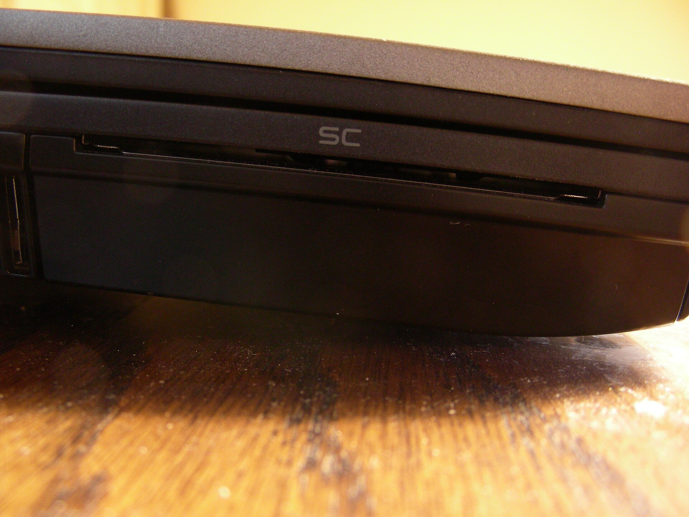

You have a digital signature certificate and a PDF that needs signing. What do you open?

The answer depends on where your key lives, which computer you use and how many documents you sign. This guide compares the tools people actually use in Nepal, gives the steps for the common ones and explains the two warnings that confuse most first-time signers. Prices come from vendor pages we read on 20 October 2026. Where we could not read a price, we say so.

If you do not have a certificate yet, read [how to get a digital signature certificate in Nepal](/blog/how-to-get-digital-signature-certificate-nepal) first, and [what it costs](/blog/digital-signature-certificate-price-nepal). If you are not sure a digital signature is what the other side wants, [digital signature or electronic signature](/blog/digital-signature-vs-electronic-signature) explains the difference.

## What you need before you open any tool

Three things, whichever program you choose.

1. **A certificate from a licensed certifying authority**, with its private key stored somewhere you control. Nepal Certifying Company's manuals list the prerequisites for a token this way: the token driver is installed, the certificate is enrolled inside the token, and a PDF program is installed.
2. **The PDF in its final form.** A signature covers the exact file. Change a comma afterwards and the signature fails. The [signed PDF check guide](/blog/how-to-check-a-signed-pdf) shows what a failure looks like.
3. **A way to unlock the key.** For a token, a PIN. For a phone, your fingerprint or face. For a file, a password.

That second item is the one people skip. Finish every edit, every page order change and every redaction before the first signature goes on.

## The tools compared

| Tool | Cost | Signs with a USB token | Platforms | Notes |
|---|---|---|---|---|
| Adobe Acrobat Reader | Free to download | Yes, by loading the token's PKCS#11 module | Windows, Mac | The tool Nepal Certifying Company's manuals use |
| Adobe Acrobat Standard or Pro | Subscription. We could not read the price | Yes | Windows, Mac | Adds editing, converting and forms. Pro 2024 is also sold as a one-time licence for three years |
| Foxit PDF Editor | US$129.99 per user per year, US$159.99 for Editor+. Monthly from US$10.99 | Yes on Windows, by attaching a PKCS#11 module | Windows, Mac | Foxit's pricing page, 20 October 2026 |
| Foxit PDF Reader | Free | Not confirmed for tokens. Documentation describes certificate files and the Windows store | Windows, Mac | Check with your own token before relying on it |
| LibreOffice | Free | Not tested | Windows, Mac, Linux | Sign Existing PDF command, opens the PDF in Draw |
| Okular | Free | Only through the certificate store it is set up with | Linux, others | Cannot create a certificate. Needs a signing certificate already in place |
| ePahichan app | Fee shown in the app | Not applicable. The key is on the phone | Phone | Signs PDFs and photos of paper |
| Zoho Sign | Plans from a free tier | Yes, on paid plans, with USB tokens and PFX files | Web, phone, desktop | Cloud service. See the [signing services comparison](/blog/docusign-adobe-sign-nepal-comparison) |

Everything in the table signs a PDF the same way underneath. It calculates a hash of the file, encrypts it with your private key and stores the result and your certificate inside the PDF. [What PAdES is](/glossary/pades) explains the format. The tools differ in the interface around that step, in how they reach your key, and in what they tell you when a signature is checked.

## Adobe Acrobat Reader with a USB token

This is the route Nepal's issuing side documents. The [user manual page](https://cert.com.np/user-manual) on Nepal Certifying Company's site lists a manual for signing in Acrobat Reader DC, updated 1 January 2024, a manual for multiple signing in PDF, a Mac manual, and manuals for email signing in Outlook.

Acrobat Reader is a free download, and Nepal Certifying Company links it from its [software page](https://cert.com.np/softwares). The steps below follow the company's own PDF, [Document Signing in Adobe Acrobat](https://cert.com.np/uploads/attachment/1731829867_CryptoID%20and%20HyperPKI%20Document%20signing%20for%20Adobe%20Acrobat%20Digital%20Signature.pdf), which is written for CryptoID and HyperPKI tokens. Menu names move between Adobe releases, so treat the wording as a guide.

### One-time setup

1. Install the token's software. The manual names the CryptoID SDK or the HyperPKI token manager. Check that your certificate is enrolled in the token.
2. In Acrobat, open Preferences, then Security (Enhanced), and set the options as the manual's screenshots show. Restart Acrobat afterwards.
3. In Preferences, choose Signatures, then More under Identities and Trusted Certificates.
4. Open Digital IDs, then PKCS#11 Modules and Tokens, and click Attach Module.
5. Point it at the token's library file. On 64-bit Windows with 64-bit Adobe, the manual gives `C:\Windows\System32\CryptoIDA_pkcs11.dll`. With 32-bit Adobe it gives `C:\Windows\SysWOW64\CryptoIDA_pkcs11.dll`. Mixing them is the usual reason the module will not load.
6. Select the module, click Login and enter your token password.

On a Mac, the token maker's [CryptoID Adobe Sign on Mac guide](https://cert.com.np/uploads/attachment/1674542286_mToken_CryptoID_Adobe_Sign_on_Mac.pdf), which Nepal Certifying Company hosts, follows the same path. The library there is a `.dylib` file, and the guide tells you to right-click it and copy its path.

### Signing

1. Plug in the token and open the PDF.
2. In the All tools panel, choose View more, then Use a certificate.
3. Click Digitally sign, and drag a rectangle where the signature should appear.
4. In the Sign with a Digital ID window, select your certificate on the token and click Continue, then Sign.
5. Save the signed copy under a new name. The manual warns that the signed file cannot share the original's name.
6. Enter your token PIN when asked. The signature appears in the rectangle.

The 2024 manual adds an option worth using: tick Lock Document After Signing to prevent later changes.

### Several people signing the same file

The same company's [multiple signing manual](https://cert.com.np/uploads/attachment/1704090360_Manual%20for%20Multiple%20Signing%20in%20PDF%20updated%20manual%20signed.pdf) gives one prerequisite and one warning.

- **Prerequisite.** For others to sign with a certificate in Acrobat Reader version 2023.008.20421 or later, the PDF first has to be reader-enabled in Acrobat DC 2023. The manual does it in Acrobat DC, not in Reader.
- **Warning.** The manual describes a chain. A signs and sends to B. B edits the document, so A's signature becomes invalid. B signs and sends to C. C sees B's valid signature, A's altered signature and a notice that the content was modified.

The lesson is plain. If more than one person signs, agree the final text first and let nobody edit between signatures.

## Why a correct signature may show a warning

Nobody explains this clearly the first time, and it makes people think they did something wrong.

After signing, Acrobat may show the message "At least one signature has problems". The company's manual says not to worry: "it is not the certificate issue. It means the certificate is not trusted by your computer."

The three questions in a signature check are about the file, the signer and the trust. The warning is a pass on the first two and a gap on the third. Acrobat does not yet know that the authority that issued your certificate is one to trust.

The manual's fix has you open the signature, choose Signature Properties and add the certificate as a trusted certificate. It adds: "please exercise caution". After you finish and reopen the file, the signature shows as valid.

> [!WARNING]
> Adding a certificate as trusted tells your computer to accept everything that chains to it. Only do this for the issuing authority's own root, and get that root from the authority. The [Radiant CA site](https://radiantca.com.np/) offers a root certificates download, and the National Cyber Security Center, which now holds the Controller's functions, has a [root CA certificate page](https://ncsc.gov.np/pages/1084212722/). Do not add a certificate because a signed PDF from a stranger told you to.

A different message means something else. If Acrobat says the document was changed after signing, the signature itself is intact and the file is not the one that was signed. Do not trust that file. [How to check a signed PDF](/blog/how-to-check-a-signed-pdf) covers both cases.

## Foxit PDF Editor and Reader

Foxit is the common paid alternative to Acrobat, and the pricing is on its page. On [Foxit's PDF Editor pricing page](https://www.foxit.com/pdf-editor/pricing/) the FAQ says Foxit PDF Editor costs US$129.99 per user per year and Foxit PDF Editor+ US$159.99 per user per year, with monthly billing from US$10.99. We read that on 20 October 2026. The page does not give a monthly price for each plan.

For tokens, Foxit's [Windows user guide](https://www.foxit.com/resource-hub/user-guide/foxit-pdf-editor-for-windows/signature/) has the same setup Adobe has. Under Module Settings you click Attach Module and browse to the PKCS#11 library, then you may be asked for a PIN or password. The guide adds that the specific steps vary with the module, so read your token's documentation.

Foxit PDF Reader is free. Foxit's help pages for it describe digital IDs as files protected by a password (PKCS#12) or entries in the Windows certificate store. We did not find a source saying the free Reader loads a PKCS#11 token, so test your token before you rely on it.

## LibreOffice: a free way to sign an existing PDF

LibreOffice has a command for this. The [help page](https://help.libreoffice.org/latest/en-US/text/shared/01/signexistingpdf.html) says: choose File, then Digital Signatures, then Sign Existing PDF. In the tabbed interface the command sits directly on the File menu. The PDF opens in LibreOffice Draw in read-only mode, and you sign it as you would any document.

LibreOffice's own [digital signature help](https://help.libreoffice.org/latest/en-US/text/shared/guide/digital_signatures.html) is useful for what it tells you when you check a signature. It lists four states in the status bar:

- the signature is valid;
- the signature is fine but the certificates could not be validated;
- the signature and certificate are fine but not all parts of the document are signed;
- the signature is invalid.

For a PDF specifically, the help says that signing only parts of the document is "simply an invalid signature", so the middle state does not apply.

We did not test whether LibreOffice reaches a USB token on each platform. If your certificate is a PFX file, LibreOffice is the simplest free route. If it is a token, try Acrobat Reader first.

## Okular on Linux

Okular's documentation says you need a proper PKCS signing certificate already available on your system, because Okular cannot create one. It relies on the NSS library to handle certificates. We read this through a search summary of the KDE documentation rather than the page itself, and a KDE forum thread reports a user whose hardware token worked in Firefox and not in Okular. Treat it as the option of last resort if you are on Linux and have a certificate file.

## Adobe Acrobat Standard and Pro

Adobe sells Acrobat Standard and Pro as subscriptions, and its [compare plans page](https://www.adobe.com/acrobat/pricing/compare-versions.html) puts them next to an Express tier. It also sells Acrobat Pro 2024 as a desktop-only product with a one-time payment for a three-year term and no subscription.

We cannot give you a price. Adobe's pricing page showed us a template with the prices missing, and its servers refused our automated requests for the other pricing pages. Third-party sites quote different figures for the same plan, and we do not repeat those. Open the page in your browser, pick your country and read the number there.

Do you need it? For the basic task of putting a certificate-based signature on a finished PDF, the manuals above show you do not, since Nepal Certifying Company's own documents use the free Reader. The manuals show where the paid Acrobat comes in: preparing a reader-enabled document for multiple signers. Editing the PDF and building forms are the other reasons people buy it, as Adobe's own plan comparison describes.

## Signing on a phone

The token manuals above are for desktop readers. A phone changes where the key lives, and with it the tool.

The ePahichan app is built for this case. According to its [product page](/products/app), you apply with your citizenship document and a selfie, pay by Fonepay or a bank or wallet app, and then sign a PDF or a photo of a paper page with your fingerprint or face. The signing key is created on your phone and stays in its secure hardware, so there is no token and no driver. You can also send a document to several people and see who has signed. The site does not publish a price for the certificate, because the app shows the fee before you pay.

Two points worth knowing before you choose a phone route:

- The key is bound to the phone. If you lose the phone, ask for the certificate to be revoked, as with a lost token.
- Whoever you send the PDF to can check it on a computer with any reader. The signature is a normal PDF signature, and the [PAdES guide](/glossary/pades) explains why.

## Cloud signing services

Services such as DocuSign, Adobe Acrobat Sign and Zoho Sign add workflows: sending a document to several signers, reminders and an audit trail. Whether their signatures meet the Electronic Transactions Act is a separate question, and we cover it with prices in [DocuSign, Adobe Acrobat Sign, Zoho Sign and local signing in Nepal](/blog/docusign-adobe-sign-nepal-comparison).

One fact is useful here. Zoho's [pricing page](https://www.zoho.com/sign/pricing.html) lists "Sign using non-Zoho DSC" on the Standard plan and above, described as using your own digital signature certificates from USB tokens and PFX files. A certificate you already hold can therefore be used in that service.

## Which should you pick

- **You sign a few documents a month on a Windows or Mac computer, with a token.** Acrobat Reader and the issuer's manual. It is free, and the manual matches your token.
- **You sign with a PFX file, and you want free software.** LibreOffice's Sign Existing PDF.
- **You prepare documents for several people to sign.** Acrobat Pro or Foxit PDF Editor, for the preparation step, then each signer uses whatever reader they like.
- **You sign on the move, or you do not want a token.** A phone app such as ePahichan.
- **You send documents to outside signers on a schedule.** A cloud service, after you check the legal fit.

## A short checklist before you press Sign

- The document is final and proofread.
- You are signing with the right certificate. If you hold a personal and an organisation certificate, check which one the tool selected.
- You are saving to a new file name and keeping the unsigned original.
- You have written down the certificate's expiry date. See [what happens when the certificate expires](/blog/signature-after-certificate-expires).
- If the document is one the Act excludes, such as a will or a deed that transfers title to land, a digital signature is not enough. See [documents you cannot sign digitally in Nepal](/blog/documents-not-signed-digitally-nepal).

## What we could not verify

- Adobe's current prices for Acrobat Standard and Pro.
- Whether Adobe's built-in trusted list includes Nepal's root. The company's manual indicates it does not by default, since it walks you through adding the certificate, but we did not test it.
- Whether the free Foxit Reader or LibreOffice reaches a PKCS#11 token on your system. Test with your own token.
- The full Okular documentation page, which we saw only through a summary.
